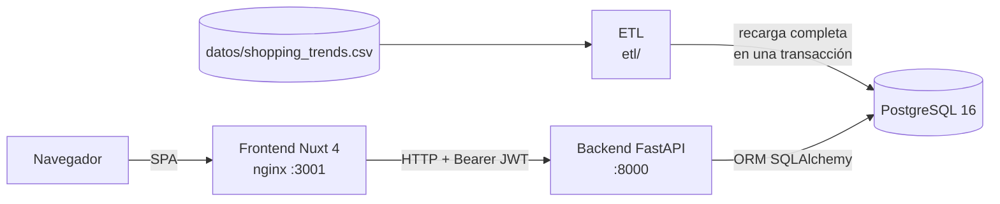
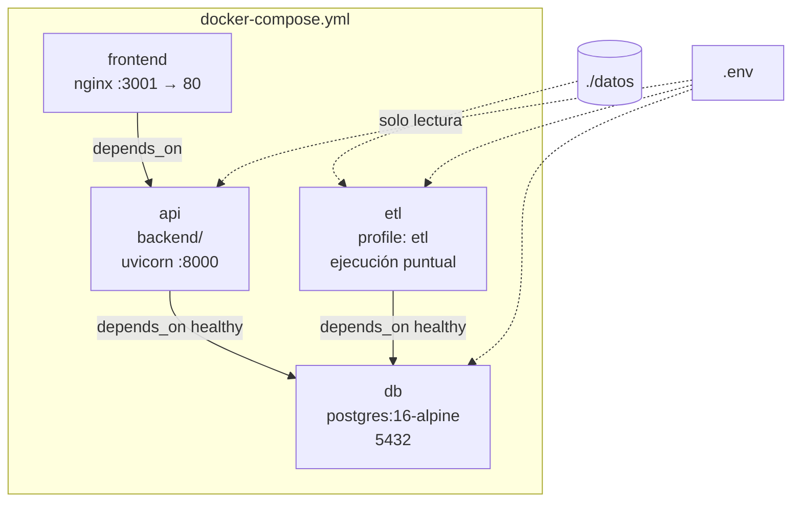
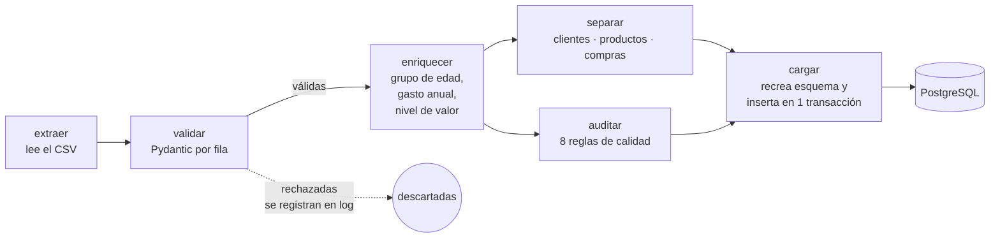
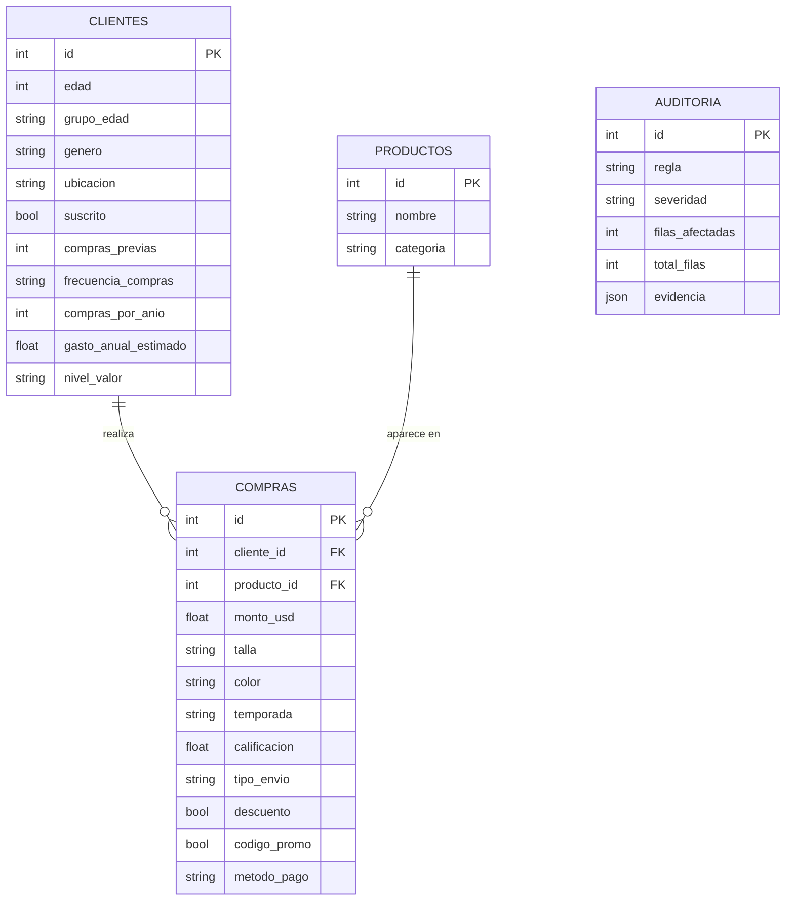
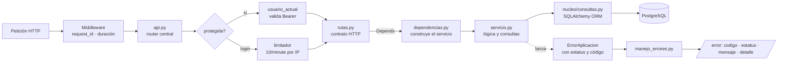
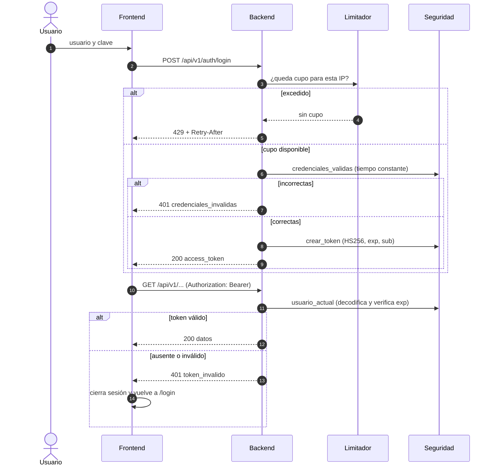
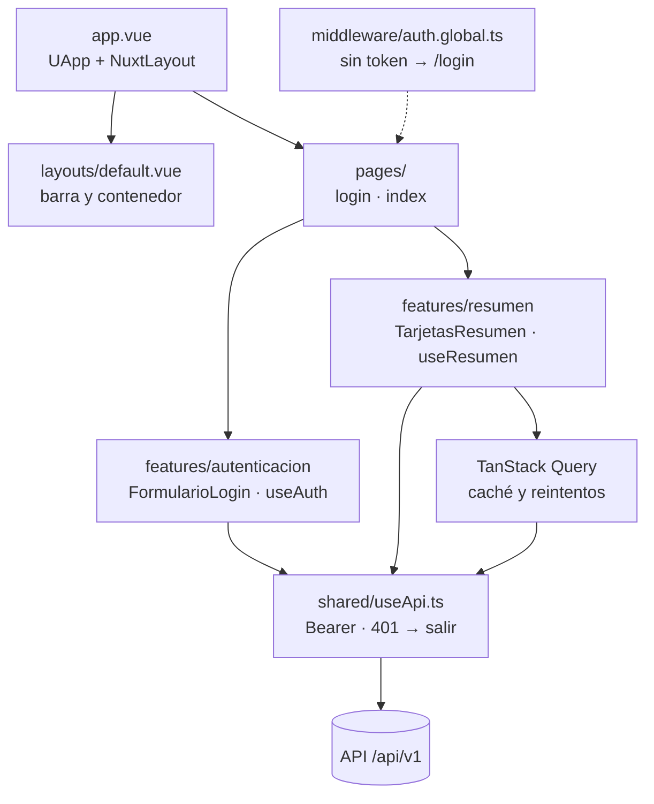

# Arquitectura · Tendencias de compra · Hola Moda

Pipeline de datos de punta a punta: un CSV de compras se carga a PostgreSQL con un ETL, una API
FastAPI lo expone con autenticación JWT, y un dashboard Nuxt lo visualiza. Cada pregunta de negocio es
una funcionalidad completa (ruta, servicio, esquemas y tests en su propia carpeta).

## 1. Vista general



El ETL es un proceso bajo demanda; la API y el frontend son servicios permanentes. La base es el único
punto de contacto entre el ETL y la API: no se comunican de otra forma.

## 2. Contenedores (Docker Compose)



| Servicio | Imagen | Puerto | Notas |
|---|---|---|---|
| `db` | postgres:16-alpine | 5432 | Volumen `pgdata`; healthcheck con `pg_isready` |
| `api` | `backend/` (Python 3.12) | 8000 | Espera a `db` healthy |
| `frontend` | `frontend/` (Node → nginx) | 3001 | SPA estática con fallback a `index.html` |
| `etl` | `etl/` (Python 3.12) | — | Solo con `docker compose run --rm etl` |

## 3. Pipeline ETL



Propiedades del ETL:
- **Idempotente:** cada corrida recrea el esquema y carga todo de nuevo; repetirla da el mismo resultado.
- **Atómico:** Postgres tiene DDL transaccional, así que si algo falla la base queda como estaba.
- **Tolerante a reglas defectuosas:** si una regla de auditoría falla, se registra y la carga continúa.
- **Sin dependencias pesadas:** la correlación de Spearman se calcula con pandas (sin scipy).

## 4. Modelo de datos



El dataset trae una compra por cliente, así que `compras.id` coincide con `clientes.id`. La tabla
`auditoria` no se relaciona con las demás: guarda hallazgos sobre el conjunto completo.

## 5. Backend

### 5.1 Capas de una petición



Reglas de dependencia (de afuera hacia adentro):
- Las **rutas** solo conocen HTTP: parámetros, códigos y el contrato de respuesta.
- Los **servicios** no importan FastAPI: reciben una sesión y devuelven datos o lanzan errores de aplicación.
- El **núcleo** (`nucleo/`) es lo transversal: configuración, sesión, seguridad, errores, logs y modelos.
- Las funcionalidades **no dependen entre sí**; solo comparten el núcleo.

### 5.2 Estructura de carpetas

```
backend/
├── app/
│   ├── main.py                 arranque: CORS, middleware, manejadores de error
│   ├── api.py                  router central /api/v1 (público y protegido)
│   ├── funcionalidades/
│   │   └── <nombre>/
│   │       ├── rutas.py        endpoints (contrato HTTP)
│   │       ├── dependencias.py obtener_servicio (inyección)
│   │       ├── servicio.py     lógica y consultas
│   │       └── esquemas.py     modelos de respuesta
│   └── nucleo/
│       ├── config.py           variables de entorno tipadas
│       ├── db.py               engine y sesión por petición
│       ├── modelos.py          modelos ORM de lectura
│       ├── consultas.py        joins y utilidades comunes
│       ├── seguridad.py        JWT y comparación de credenciales
│       ├── errores.py          errores de aplicación (estatus + código)
│       ├── respuestas.py       formato único de error
│       ├── manejo_errores.py   convierte cualquier error en respuesta
│       ├── limitador.py        slowapi (login)
│       └── logs.py             loguru + interceptación de logging
└── tests/
    ├── conftest.py
    ├── funcionalidades/<nombre>/   pruebas de integración y unitarias
    └── nucleo/                     contrato de errores, protección, logs
```

### 5.3 Autenticación



- El secreto JWT tiene al menos 32 caracteres; la aplicación no arranca sin él.
- Hay un único usuario administrador, definido en `.env`.
- La protección está en un solo lugar: `api.py` aplica `usuario_actual` al router `protegida`.
  Una prueba falla si alguna ruta bajo `/api/v1` queda sin protección, salvo el login.

### 5.4 Errores

Todo error de la API responde con el mismo formato:

```json
{"error": {"codigo": "datos_insuficientes", "estatus": 422, "mensaje": "No hay variación suficiente…"}}
```

| Código | Estatus | Quién lo origina |
|---|---|---|
| `credenciales_invalidas` | 401 | Servicio de autenticación |
| `token_invalido` | 401 | Dependencia de seguridad |
| `datos_insuficientes` | 422 | Servicio de hipótesis |
| `validacion` | 422 | FastAPI (parámetros) |
| `limite_excedido` | 429 | Limitador de login |
| `no_encontrado` | 404 | Ruta inexistente |
| `servicio_no_disponible` | 503 | Error de base de datos |
| `error_interno` | 500 | Excepción no controlada (sin detalles internos) |

Cada ruta documenta estos errores en OpenAPI con el mismo esquema `ErrorRespuesta`.

### 5.5 Logs

Un único logger (loguru) para la aplicación, uvicorn, SQLAlchemy y slowapi. Cada petición lleva un
`request_id` (de la cabecera `X-Request-ID` o generado) y se registra con estatus y duración.
`LOG_NIVEL` controla el detalle.

## 6. Frontend



- **SPA** (`ssr: false`): la app está detrás de login, así que no hay nada que renderizar en servidor.
- **Estructura por funcionalidad:** `features/<nombre>/` agrupa componentes, composables y tipos.
  `shared/` contiene lo transversal (cliente HTTP, formato). Las páginas solo componen componentes.
- **Token:** vive en memoria y en `sessionStorage` (se borra al cerrar la pestaña).
- **Caché:** TanStack Query con `staleTime` de 60 s, porque los datos solo cambian al correr el ETL.

## 7. Endpoints

Todos bajo `/api/v1`, con Bearer salvo `auth/login`.

| Ruta | Pregunta de negocio |
|---|---|
| `POST /auth/login` | Obtener token |
| `GET /resumen` | Indicadores generales |
| `GET /compras` | Listado paginado con filtros |
| `GET /productos/promocion` | ¿De qué producto lanzar una promoción? |
| `GET /productos/satisfaccion` | Calificación con margen de error |
| `GET /productos/estacionalidad` | Temporada pico y valle por producto |
| `GET /estados/top-productos` | Producto líder por estado, con talla y color |
| `GET /tallas/curva` | Curva de tallas por categoría |
| `GET /suscripcion/impacto` | ¿Vale la pena la suscripción? |
| `GET /clientes/valor` | Segmentación por valor y Pareto |
| `GET /envios/por-segmento` | Tipo de envío por segmento |
| `GET /calidad/auditoria` | Hallazgos de calidad del ETL |
| `GET /hipotesis` | Kruskal-Wallis con corrección de Bonferroni |

`GET /salud` es público y verifica el servicio y la base.

## 8. Decisiones clave

| Tema | Decisión | Motivo |
|---|---|---|
| Datos | Customer Shopping Trends | Caso cercano al retail de moda |
| ETL | Script Python, no orquestador | Dataset pequeño; Airflow sería sobreingeniería |
| Validación | Por fila (Pydantic) y por conjunto (auditoría) | Los problemas del dataset solo se ven en conjunto |
| Segmentación | Por valor (cuartiles), no K-means | La única heterogeneidad real es el gasto; K-means sobre ruido uniforme no aporta |
| Consultas | ORM SQLAlchemy | Legible y testeable; las agregaciones siguen en la base |
| Arquitectura | Vertical slicing + capa de servicios + DI | Cada funcionalidad se entiende y se prueba por separado |
| Frontend | Nuxt 4 SPA + Nuxt UI + TanStack Query | SPA detrás de login; componentes listos; caché de datos |
| Autenticación | JWT HS256 con usuario en `.env` | Un solo operador; sin tabla de usuarios |
| Límite de login | 10 por minuto por IP | Frena fuerza bruta sin bloquear el uso normal |

## 9. Limitaciones conocidas

- **Sin fechas de compra:** no hay tendencias en el tiempo ni retención.
- **Límites en memoria:** el limitador de login guarda sus contadores por proceso. Con varias réplicas
  habría que usar Redis (`storage_uri`).
- **Un solo usuario administrador.** Con más usuarios haría falta tabla de usuarios y hash de claves.
- **Dataset sintético:** la auditoría lo señala; las conclusiones se presentan con esa salvedad.
